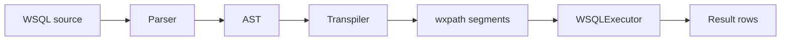

# WSQL

WSQL is a declarative, SQL-like language for web crawling and extraction. You write
queries that look like SQL; WSQL parses them, transpiles to [wxpath](https://github.com/rodricios/wxpath),
and executes them over the web.

The central idea: **`INNER JOIN` directs a crawl**. A CTE produces rows; each row
templates a URL for the main query. That turns relational dependencies into crawl plans
that wxpath alone cannot express.

## Architecture



1. **Parser** - recursive-descent parser builds an AST (`WSQLProgram`, CTEs, JOINs).
2. **Transpiler** - converts each query into wxpath-compatible segment lists.
3. **Executor** - orchestrates CTE DAGs, horizontal JOIN fan-out, and HTTP via wxpath.

## Quick start

### Install

```bash
git clone https://github.com/rodricios/wsql.git
cd wsql
uv sync --extra test
```

Or with pip:

```bash
pip install -e ".[test]"
```

### Run a query

```python
from wsql import wsql_execute

results = wsql_execute("""
    SELECT //h1/text() AS title
    FROM https://example.com
    DEPTH 1
""")

print(results[0]['title'])
```

`wsql_execute` is synchronous and creates its own event loop. For async control, use
`WSQLExecutor` directly.

## Example: quotes to Wikipedia

This query crawls quotes.toscrape.com, then fetches each author's Wikipedia page using
the author name from the CTE row:

```sql
WITH author_bios AS (
    SELECT
        string(base-uri(.)) AS url,
        .//small[@class='author']/text() AS author
    FROM https://quotes.toscrape.com
        PER //div[@class='row']//div[@class='quote']
        FOLLOW //li[@class='next']/a/@href
        DEPTH 2
)
SELECT
    string-join(//main[@id='content']//p/text(), ' ') AS wiki_text,
    author_bios.author,
    author_bios.url AS quotes_toscrape_url
FROM https://en.wikipedia.org/wiki/{author_bios.author}
    DEPTH 1
INNER JOIN author_bios
    ON author_bios.author
```

From Python:

```python
from wsql import wsql_execute

query = '''
WITH author_bios AS (
    SELECT
        string(base-uri(.)) AS url,
        .//small[@class='author']/text() AS author
    FROM https://quotes.toscrape.com
        PER //div[@class='row']//div[@class='quote']
        FOLLOW //li[@class='next']/a/@href
        DEPTH 2
)
SELECT
    string-join(//main[@id='content']//p/text(), ' ') AS wiki_text,
    author_bios.author,
    author_bios.url AS quotes_toscrape_url
FROM https://en.wikipedia.org/wiki/{author_bios.author}
    DEPTH 1
INNER JOIN author_bios
    ON author_bios.author
'''

for row in wsql_execute(query):
    print(row.get('author'), '->', row.get('wiki_text', '')[:80], '...')
```

Each CTE row becomes one Wikipedia fetch. The JOIN is not a table join in the SQL sense;
it is a **dependency-directed crawl**.

## Language overview

### Single-page extraction

```sql
SELECT
    string(base-uri(.)) AS url,
    ./span[@class='text']/text() AS quote,
    .//small[@class='author']/text() AS author
FROM https://quotes.toscrape.com
    PER //div[@class='row']//div[@class='quote']
    FOLLOW //li[@class='next']/a/@href
    DEPTH 5
```

- `PER` - row anchor XPath (iterate over matched elements).
- `FOLLOW` - link XPath for pagination / discovery.
- `DEPTH` - maximum crawl depth.

### Button-press pagination (`CLICK` / `PAGES`)

Documentation generated by LLM - requires human review

Some tables paginate via a JavaScript button ("Next", DataTables `paginate_button`)
instead of a link with a fetchable `href`. `FOLLOW` cannot express this when there
is no link to follow. `CLICK` fills that gap: it names an XPath to an on-page
control, clicks it on a live Playwright page, re-extracts, and repeats.

```sql
SELECT
    td[@class='name-column']//text() AS name,
    td[@class='money-column'][2]//text() AS annual_salary
FROM https://www.capology.com/uk/premier-league/salaries/
    PER //tbody/tr
    CLICK //a[@aria-label='next page']
    PAGES 20
    CRAWLER playwright
```

- `CLICK <xpath>` - XPath naming the pagination control to click on the current page.
- `PAGES <int>` - maximum number of page snapshots to extract.
- If `PAGES` is omitted, the browser stops when the control disappears or after
  100 pages, whichever comes first. The first page counts toward the limit.
- `CLICK` requires `CRAWLER playwright` (a real browser page must stay open across
  clicks); the executor raises a clear error if another crawler is selected.
- `FOLLOW` and `CLICK` cannot be combined on the same `FROM` clause.
- `PAGES` requires `CLICK` and must be positive.
- `CLICK` within a URL-producing `FROM (SELECT ...)` subquery is not supported.

Transpiles to wxpath's `wx:paginate(...)` operator.
Install the browser extra with `uv sync --extra playwright`, then install
Chromium with `uv run playwright install chromium` before running a `CLICK` query.

END: Documentation generated by LLM - requires human review

### Subqueries (URL generation)

In WSQL, a `FROM (SELECT ...) AS alias` subquery does **not** materialize a temp table.
The subquery's single `SELECT` column produces URLs to fetch:

```sql
SELECT
    string(base-uri(.)) AS url,
    //h3[@class='author-title']/text() AS name
FROM (
    SELECT //a[contains(@href, '/author/')]/@href
    FROM https://quotes.toscrape.com
        FOLLOW //li[@class='next']/a/@href
        DEPTH 5
) AS author_links
    DEPTH 1
```

### Parallel CTE dependencies

Multiple CTEs can depend on the same parent and run in parallel:

```sql
WITH author_bios AS (
    SELECT
        string(base-uri(.)) AS url,
        //h3[@class='author-title']/text() AS name
    FROM https://quotes.toscrape.com
        FOLLOW //li[@class='next']/a/@href
        DEPTH 5
), grokipedia_pages AS (
    SELECT
        string(base-uri(.)) AS url,
        //h1/text() AS title
    FROM https://grokipedia.com/page/{author_bios.name}
        DEPTH 1
)
SELECT
    author_bios.name,
    grokipedia_pages.title
FROM https://example.com
    DEPTH 1
INNER JOIN author_bios ON author_bios.name
INNER JOIN grokipedia_pages ON grokipedia_pages.title
```

### Sequential CTE chains

CTEs can feed each other in a pipeline (quotes -> Wikipedia -> search):

```sql
WITH author_bios AS (
    SELECT
        string(base-uri(.)) AS url,
        .//small[@class='author']/text() AS author
    FROM https://quotes.toscrape.com
        PER //div[@class='row']//div[@class='quote']
        FOLLOW //li[@class='next']/a/@href
        DEPTH 1
), wikipedia_pages AS (
    SELECT
        author_bios.author AS author_name,
        string(base-uri(.)) AS wikipedia_url
    FROM https://en.wikipedia.org/wiki/{author_bios.author}
        DEPTH 1
)
SELECT
    string(base-uri(.)) AS google_url,
    wikipedia_pages.wikipedia_url,
    author_bios.author
FROM https://www.google.com/search?q={wikipedia_pages.wikipedia_url}
    DEPTH 1
INNER JOIN author_bios ON author_bios.author
INNER JOIN wikipedia_pages ON wikipedia_pages.wikipedia_url
```

## Development

```bash
uv sync --extra test --extra dev
uv run ruff check src tests
uv run ruff format src tests
uv run pytest
```

See [CONTRIBUTING.md](CONTRIBUTING.md) for contribution guidelines.

## Documentation and links

- [Documentation](https://rodricios.github.io/wsql) (in progress)
- [Changelog](CHANGELOG.md)
- [wxpath](https://github.com/rodricios/wxpath) - execution engine
- [Issue tracker](https://github.com/rodricios/wsql/issues)

## License

WSQL is licensed under the [GNU Affero General Public License v3.0](LICENSE) (AGPL-3.0).

If you modify WSQL and run it as a network service that users interact with, AGPL-3.0
requires you to make your modified source available to those users. For proprietary or
closed-source use, contact the author about alternative licensing.
